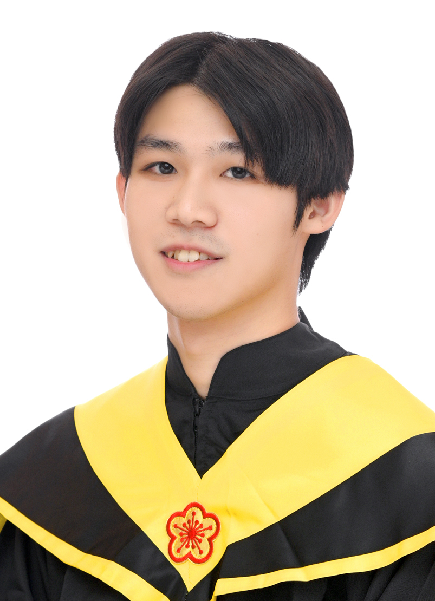

<!-- Centered profile picture -->
<!-- 

  

 -->

<!-- **Looking for PhD position in robotics!!** -->

Hi, this is Wei-Hsuan Cheng (he/him). I am a robotics researcher (Associate Researcher) at **[Delta Robotics Innovation Center (DRIC)][DRIC]**, where I focus primarily on **model predictive control (MPC)**, together with other model-based control and estimation methods (e.g. force control, KF-family), across various robotic embodiments, including dual-arm systems, dexterous hands, mobile manipulators, and integrated combinations of these platforms.

## Model predictive control

I build MPC controllers that run in `ros2_control`, from robotic arms to humanoids and wheeled-legged robots:

<table align="center">
  <tr>
    <td align="center" width="25%">
      
    </td>
    <td align="center" width="75%">
      
    </td>
  </tr>
  <tr>
    <td align="center"><b><a href="/project/2026-10-legged-robot-mpc">Legged Robot MPC</a></b> Whole-body inverse-dynamics MPC for humanoids and wheeled bipeds</td>
    <td align="center"><b><a href="/project/2026-06-robotic-arm-dynamics-mpc">Robotic Arm Dynamics MPC</a></b> Inverse- and forward-dynamics MPC for robotic arms</td>
  </tr>
</table>

  
What I am obsessed with in MPC

  

    

      <i class="fas fa-binoculars" aria-hidden="true"></i>
      Forecast
      
Its forecast to future possibilities over a horizon

    

    

      <i class="fas fa-sliders" aria-hidden="true"></i>
      Steer
      
Its flexibility to steer different behaviors with costs

    

    

      <i class="fas fa-scale-balanced" aria-hidden="true"></i>
      Balance
      
Its smoothness in handling multiple competing objectives and constraints

    

  

  
<i class="fas fa-layer-group" aria-hidden="true"></i> All with a unified strategy

## Background

Previously, I completed my Master's degree at [Robots and Medical Mechatronics Lab (RMML)][RMML], [Department of Biomechatronics Engineering][NTUBME], [National Taiwan University (NTU)][NTU], advised by *[Prof. Ping-Lang Yen]*.

- Master's thesis title: *“Application of Vision- and Force-Based Supervisory Teleoperation for Robotic Dexterous Manipulation Tasks in Industrial Surveillance”*

My research interests lie in ``robotics``, particularly model-based control and estimation for contact-rich/compliant manipulation and legged/wheeled-legged locomotion. I have experience in diverse domains in robotics, including but not limited to
- ``Model predictive control (MPC)`` (kinematics and dynamics MPC, whole-body inverse-dynamics MPC)
- ``Whole-body control (WBC)``
- ``Kalman filtering`` (KF, EKF, UKF, InEKF, etc.)
- ``Teleoperation`` robotic system through ``wireless communication``
- ``Compliance control`` (force, admittance, and impedance control)
- Robotic ``dexterous`` manipulations (contact-rich, physical interactions, compliant motions, etc.)
- Robotic arm ``vision-based control`` (visual servoing, 6D pose estimation and tracking)
- Application of ``geometric algebra`` in robotics

Check out my [projects] and [resume] here. Reach out if you’re intereted in what I’m doing!

[DRIC]: https://www.deltaww.com/en-US/company/innovation
[RMML]: http://rmml.bime.ntu.edu.tw/nturmmle.html
[NTUBME]: https://www.bime.ntu.edu.tw/English/Default.html
[NTU]: https://www.ntu.edu.tw/english/
[Prof. Ping-Lang Yen]: http://rmml.bime.ntu.edu.tw/profe.html
[projects]: /projects/
[resume]: /cv/
